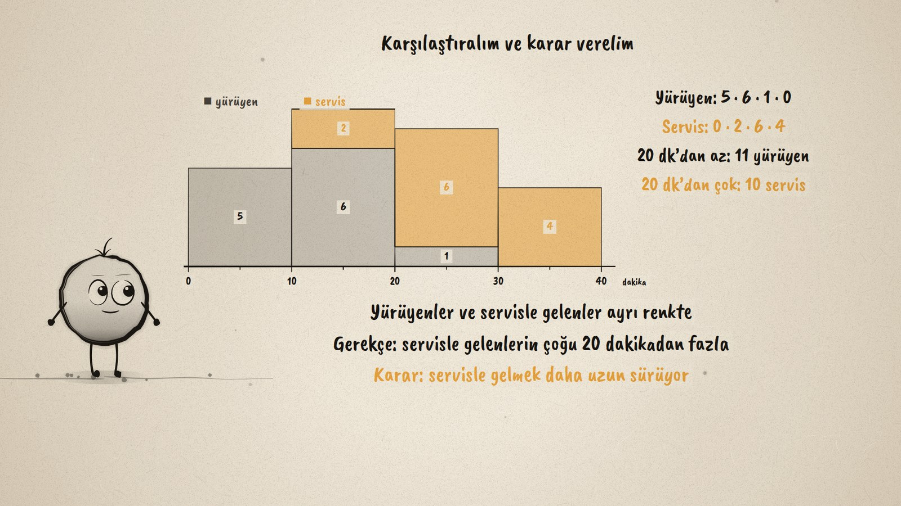
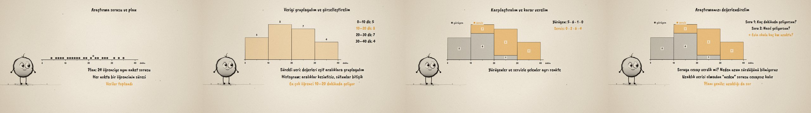

# Okula Kaç Dakika? · A Statistical Investigation with Continuous Data

**▶ Tarayıcıda izleyin / Watch in the browser:** https://hakanatas.github.io/okula-kac-dakika/ 
**⬇ MP4 + altyazılar / MP4 + subtitles:** [Releases](https://github.com/hakanatas/okula-kac-dakika/releases) 
**✎ Kullanılan istem / The prompt behind it:** [PROMPT.md](PROMPT.md) 
**🎞 Bütün filmler / All films:** [Nokta'nın Filmleri](https://hakanatas.github.io/nokta-filmleri/?sinif=7)

> **TR —** 7. sınıf matematik "İstatistiksel Araştırma Süreci" temasındaki MAT.7.6.1 öğrenme çıktısı için hazırlanmış, tamamen JavaScript ile çizilen 92 saniyelik mürekkep animasyonu. "Nasıl geliyorsun?" sorusunun cevapları kategorik, "Kaç dakikada geliyorsun?" sorusunun cevabı ölçülür: nicel ve sürekli bir veri. Bir sınıf araştırma sorusu kuruyor (okula kaç dakikada geliyoruz, yürüyenler ile servisle gelenler farklı mı?), plan yapıyor ve 24 öğrenciye aynı anket sorusunu soruyor; her cevap sayı doğrusunda bir nokta oluyor. Sürekli veri eşit aralıklara gruplanıyor (0–10, 10–20, 20–30, 30–40 dakika: 5, 8, 7, 4) ve bitişik sütunlu bir histogramla gösteriliyor. Yürüyenler ve servisle gelenler ayrı renkte karşılaştırılıyor; karar veriyle gerekçelendiriliyor: servisle gelenlerin 10'u 20 dakikadan fazla sürede geliyor. Son olarak araştırma değerlendiriliyor: "neden" sorusu için veri eksik, plan ankete uzaklık sorusu eklenerek yenileniyor. Altyazılar Türkçe, İngilizce ya da ikisi birlikte seçilebilir.

A 92-second ink animation for **7th-grade maths**. Nokta, the ink character from [The Learning Ink](https://github.com/hakanatas/the-learning-ink), is the guide again. The 24 answers are two short lists in `scenes/scene1.js` (walkers and bus riders); the dots, the interval counts, the histogram and its split into two colours are all computed from those lists, so changing one answer changes every picture.

## Learning outcome

MEB, Türkiye Yüzyılı Maarif Modeli, Ortaokul Matematik, 7th grade, "İstatistiksel Araştırma Süreci" theme:

**MAT.7.6.1. Kategorik veya nicel (sürekli) veri ile çalışabilme ve veriye dayalı karar verebilme**
- a) Kategorik veya nicel (sürekli) veriye dayanan istatistiksel araştırma gerektiren durumları fark eder.
- b) Kategorik veya nicel (sürekli) veriye dayanan betimleme veya karşılaştırma gerektirebilecek araştırma soruları oluşturur.
- c) Kategorik veya nicel (sürekli) veriye ulaşmak için plan yapar.
- ç) Araştırma sorusuna uygun hazırlanan anket sorularını kullanarak veri toplar veya hazır veriye ulaşır.
- d) Veri görselleştirme ve özetleme araçlarını seçme gerekçelerini belirtir.
- e) Toplanan veriyi uygun araçlarla analiz eder.
- f) Araştırmada ulaştığı sonuçlara yönelik gerekçeler sunar.
- g) Araştırma sonuçlarının araştırma sorusuna ne düzeyde cevap verdiğini değerlendirerek uygun olmayan adımları yeniden planlar.

## Scenes

| # | Time | Scene | What happens | Outcome |
|---|---|---|---|---|
| 1 | 0–10 s | Soru | Categorical ("how?") or continuous ("how many minutes?") data. | a |
| 2 | 10–28 s | Plan | A research question with a comparison, a plan, 24 answers on a number line. | b, c, ç |
| 3 | 28–46 s | Histogram | Equal intervals 5 · 8 · 7 · 4 and a histogram with touching bars. | d, e |
| 4 | 46–64 s | Karşılaştır | Walkers and bus riders in two colours; a decision justified by the data. | e, f |
| 5 | 64–80 s | Değerlendir | The "why" is not answered; the survey gets a distance question. | g |
| 6 | 80–92 s | Aklında kalsın | Question, plan, data, histogram, decision, better plan. | a–g |

## Running it

- **Preview:** double-click `index.html` (it works offline).
- **MP4:** run `npm install` once, then `npm run export -- --format=horizontal --captions=tr`.
- **Subtitles and narration:** `npm run srt` writes `out/captions_*.srt` and `narration_notes.txt`.
- **Editing:**
  - Caption text, timings and narration notes: `captions.js`
  - Everything on screen is drawn by `LI.world(t)` in `scenes/scene1.js` (the data, the histogram, the tables, the words); the other scenes only set the camera.
  - Nokta's poses: `src/draw/film.js`; layout for 16:9 and 9:16: `src/draw/kd.js`

It uses the same engine as The Learning Ink: `renderFrame(t)` as a pure function of time, seeded randomness, and frame-by-frame export.

## Lisans · License

**TR —** Bu film ve kodu [Creative Commons Atıf-GayriTicari 4.0 Uluslararası (CC BY-NC 4.0)](https://creativecommons.org/licenses/by-nc/4.0/deed.tr) lisansıyla paylaşılır. Ticari olmayan her amaçla (derste, okulda, eğitim materyalinde) kopyalayabilir, paylaşabilir ve değiştirebilirsiniz; ancak **kaynak göstermek zorunludur**: eser sahibinin adı ve bu deponun bağlantısı belirtilmeden kullanılamaz. Ticari kullanım (satış, ücretli ürün ya da yayın) için izin alınmalıdır.

**EN —** This film and its code are licensed under [Creative Commons Attribution-NonCommercial 4.0 International (CC BY-NC 4.0)](https://creativecommons.org/licenses/by-nc/4.0/). You may copy, share and adapt them for non-commercial purposes, but **attribution is required**: they may not be used without crediting the author and linking to this repository. Commercial use requires permission.

Atıf örneği / Required credit: *“Okula Kaç Dakika?”, Hakan Ataş, Nokta'nın Filmleri — https://github.com/hakanatas/okula-kac-dakika — CC BY-NC 4.0*
